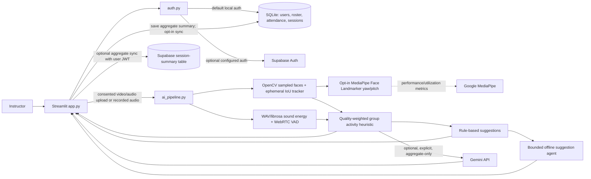
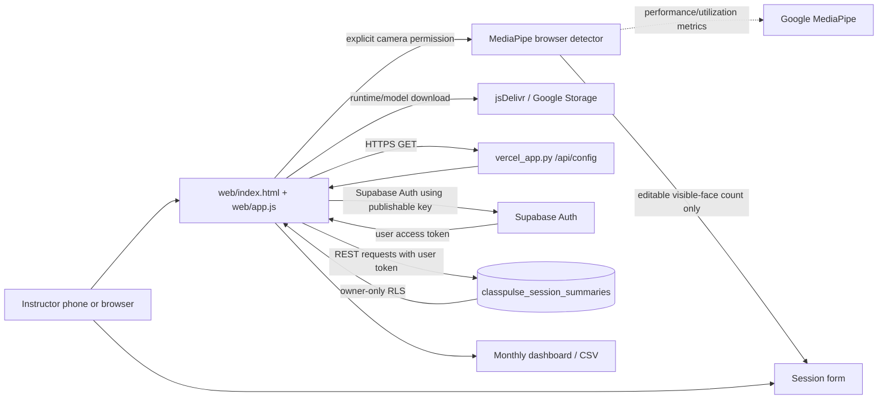

# ClassPulse requirements and architecture

This document maps the supplied project brief to the current repository. It distinguishes requested capabilities from what the local Python application and hosted Vercel preview currently implement. Estimates are instructor aids; they are not verified attendance, student identity, emotion, ability, or grading signals.

## Sources and interpretation

- **Gits PDF, slides 2–3:** project goal, scope, impact, risks, solution overview, and example technology stack.
- **Gits PDF, slides 4–7:** mobile, user, and bug checks; iterative refinement; describe → generate → refine → deploy workflow.
- **Gits PDF, slides 8–12:** examples of an AI full-stack builder, visual prompt structure, design styles, UI vocabulary, and an example React/Supabase/Netlify stack. These are references from the slides, not mandatory implementation choices.
- **Google's [MediaPipe Tasks Privacy Notice](https://developers.google.com/edge/mediapipe/solutions/privacy):** task inputs are processed on-device and not sent to Google, while performance/utilization metrics may be sent to Google; developers are responsible for informing users and obtaining consent as required.
- **User screenshot “WhatsApp Image 2026-11-20 at 10.06.15 PM.jpeg” (project overview):** functional objectives and multimodal signals.
- **User screenshot “WhatsApp Image 2026-11-20 at 10.06.16 PM.jpeg” (hardware/software requirements):** visible hardware and software baseline. The image ends partway through the Python requirement, so text below the crop is unknown.

The project owner's explicit Python/Streamlit preference takes precedence over the slides' React/Lovable/Netlify examples. The current web preview is Python-served and JavaScript-rendered, and is deployed on Vercel.

## Requirement matrix

Status definitions: **Implemented** means the capability exists in the identified mode; **Partial** means only a limited proxy/workflow exists; **Not implemented** means the current code does not provide it.

| Requirement | Source | Local Python/Streamlit | Hosted Vercel PWA | Gap or qualification |
|---|---|---|---|---|
| Reduce manual attendance effort; show attendance totals | PDF slide 2; screenshot 1 | **Partial.** Roster and present/absent status are entered and confirmed manually; CSV export is available. Video analysis can suggest a group visible-face count. | **Partial.** The optional camera estimates visible-face count and puts an editable group count into the session form. Manual counts are also supported. | Neither mode identifies a learner or automatically marks individual roster rows present. See [app.py](../app.py), [web/app.js](../web/app.js). |
| Live camera and recorded-video input | Screenshot 1 | **Partial.** Attendance view offers an opt-in live preview, plus an uploaded still-image estimate. Session analysis accepts uploaded video. The live preview itself is not piped into the Python analysis loop. | **Partial.** User-initiated live camera preview and on-device visible-face counting are available. No recorded-video upload/analysis flow is present in this UI. | Camera estimates are group counts, not identity attendance. MediaPipe runtime/model are loaded from external hosts after camera use is requested. |
| Face detection and tracking | Screenshot 1 | **Partial.** OpenCV Haar detection samples up to 48 video frames; ephemeral adjacent-frame IoU box matching estimates aggregate track count, longest duration, and coverage. MediaPipe Face Landmarker yaw/pitch runs only when explicitly enabled. | **Partial.** MediaPipe Face Detector estimates current visible-face count in repeated frames with short-window smoothing. | Local tracker state is memory-only; it returns no names, crops, embeddings, or track IDs. It is an approximate box matcher, not verified identity attendance. See [ai_pipeline.py](../ai_pipeline.py), [app.py](../app.py), and [web/app.js](../web/app.js). |
| Sustained-presence logic and timestamped attendance logs | Screenshot 1 | **Partial.** Manual roster entries have UTC `marked_at` timestamps. Session analysis records a chosen local start date/time converted to UTC and estimates group/per-track presence windows, which the result UI displays. | **Partial.** Sessions have local date/time input and only a group count is saved. | Tracking only links adjacent sampled boxes when sample spacing is at most 10 seconds; a visible track must span at least 15 seconds to count as sustained. No automatic per-student roll call or persistent entry/exit log. The local summary save does not persist detailed media windows/tracker metrics. See [app.py](../app.py), [ai_pipeline.py](../ai_pipeline.py), [storage.py](../storage.py). |
| Microphone/audio-source capture and audio analysis | Screenshot 1 | **Partial.** The UI offers upload or explicit, consent-gated microphone recording (Streamlit 1.40+). WAV energy analysis is built in, with `librosa` decoding for other formats. Local requirements include WebRTC VAD, which estimates likely-speech windows when available. | **Not implemented.** The hosted page does not request microphone access or accept audio uploads. | VAD estimates likely speech only; it does not transcribe, identify speakers, or count turns. If VAD is unavailable, the analyzer falls back to broad sound energy. See [app.py](../app.py), [ai_pipeline.py](../ai_pipeline.py). |
| Engagement analysis from head pose, movement, and inactivity | Screenshot 1 | **Partial, with major gaps.** Video analysis provides camera-relative yaw/pitch and centered-angle proxies when the instructor enables the optional local landmarker, plus scene-motion and low-motion proxies. The Streamlit result UI shows aggregate metrics and relative-progress chart. | **Not implemented as specified.** The hosted pulse estimate uses attendance and instructor-entered participation totals. | Head angles are not gaze, attention, or engagement and are not used in the fused score. Frame motion can reflect camera shake/scene changes; it is not a learner movement or inactivity detector. Scores remain heuristic, not validated engagement or emotion measures. |
| Detect speech and interaction levels | Screenshot 1 | **Partial.** RMS energy estimates sound-active windows; WebRTC VAD estimates likely-speech windows when available, without transcription or speaker identity. | **Not implemented.** No hosted audio pipeline. | Neither mode detects distinct speakers or counts conversational turns. A manual contribution total is available in the hosted form. |
| Fuse visual and audio signals | PDF slide 2; screenshot 1 | **Partial.** The local analysis aligns visual/audio temporal bins by relative clip progress and computes a quality-weighted low-confidence group activity heuristic. Broad energy-only audio is down-weighted. | **Not implemented as multimodal fusion.** Hosted score is a formula from manually supplied attendance and contribution counts; camera count is an editable attendance estimate. | Relative progress is not true timestamp synchronization. No trained fusion model or calibration study. See [ai_pipeline.py](../ai_pipeline.py), [web/app.js](../web/app.js). |
| Scores, session trends, and analytics | PDF slide 2; screenshot 1 | **Implemented with heuristic limits.** Dashboard aggregates saved sessions; local attendance view shows roster records. | **Implemented with heuristic limits.** Monthly metrics, trend chart, date/time table, recent sessions, and CSV export use the current user's saved summaries. | Trend data only becomes informative after sessions are saved; scores are approximate and should not be used for consequential decisions. See [app.py](../app.py), [storage.py](../storage.py), [web/app.js](../web/app.js). |
| AI teaching suggestions | PDF slide 2; screenshot 1 | **Partial.** An offline bounded agent runs fixed tools to inspect aggregate signal quality, choose from a small prompt catalogue, and safety-review suggestions. Optional Gemini can generate a short instructor-facing suggestion from approved aggregate metrics when explicitly enabled and configured. | **Partial.** The hosted UI uses deterministic threshold-based prompts from form totals. | The local agent is transparent and rule-based, not an autonomous LLM agent; Gemini is separate and not wired into the hosted PWA. See [teaching_agent.py](../teaching_agent.py) and [ai_pipeline.py](../ai_pipeline.py). |
| Expand signals/models and add real-time alerts | PDF slide 2 | **Not implemented.** | **Not implemented.** | Listed in the PDF as future scope, not current behavior. |
| Privacy-first processing | PDF slide 2; screenshot 1 | **Partial/implemented boundary.** Media processing is consent-gated, size/duration-limited, held in memory or temporary files, and source media is deleted after analysis. Head-orientation analysis is a separate off-by-default opt-in. Local SQLite stores individual roster and attendance records. | **Partial/implemented boundary.** Camera permission and processing begin only after user action; frames stay in the browser; only aggregate session data is sent to Supabase. | MediaPipe Tasks do not send images/video to Google, but performance/utilization metrics may be sent. Both local and hosted UIs disclose this; camera access remains user-initiated. Local SQLite lives on the computer/server running Streamlit and is not automatically synchronized or backed up. |
| Mobile install | PDF slides 4–5; repository README | Not applicable to the desktop Streamlit app. | **Implemented as a PWA.** HTTPS site can be added to a phone's home screen. | This repository does not build an APK/AAB or native Play Store package. |

## Requirements visible in the supplied screenshots

### Hardware baseline shown

- Processor: Intel Core i5, 8th generation or later, or AMD Ryzen 5 equivalent.
- Memory: 8 GB minimum; 16 GB recommended for multitasking and lab use.
- Storage: 256 GB SSD, or 500 GB HDD minimum.
- Network: stable connection of at least 10 Mbps; 20 Mbps recommended for labs and deployments.

These are supplied project baselines, not measurements from a benchmark run. Local video analysis may need more resources depending on video length, codecs, and concurrent use.

### Software baseline shown

- Operating systems: Windows 10/11, macOS Monterey or later, or Linux (Ubuntu 20.04+).
- Browser: a recent Chrome, Firefox, or Microsoft Edge.
- Editor: Visual Studio Code recommended; any preferred editor is acceptable.
- Version control: Git installed and configured.
- Additional tools: the screenshot visibly begins “Python (version 3.8 or …” and is cut off. The omitted version wording and any following software requirements cannot be confirmed.

The repository's current `pyproject.toml` declares Python **3.12 or later**. The richer local Streamlit dependency set, including OpenCV, MediaPipe, WebRTC VAD, librosa, and Supabase client, is in [requirements-streamlit.txt](../requirements-streamlit.txt). Follow repository configuration rather than assuming the cropped Python 3.8 fragment is a sufficient runtime specification.

## Current architecture

### Local Python / Streamlit path

- Local mode starts with `streamlit run app.py`; SQLite defaults to `data/classpulse.db`.
- Authentication defaults to local SQLite-backed accounts with salted PBKDF2 hashes and in-process login throttling. Supabase Auth is optional when its configuration and Python client are present.
- Manual student roster rows and individual attendance records stay in SQLite. They are not synchronized to Supabase.
- `ai_pipeline.py` analyzes uploaded video/audio and consented microphone recordings through the Streamlit server. Video sampling is capped at 48 frames; audio analysis is capped at 300 seconds. Temporary video files are removed in a `finally` block.
- Local video output includes group-visible-presence duration, ephemeral anonymous bounding-box matches (no track IDs returned), frame-motion proxies, and camera-relative yaw/pitch only when the instructor enables the unchecked-by-default Face Landmarker option. The model is downloaded from the pinned official Google-hosted URL on first use, size/archive-validated, and cached under the user's home cache; failed model/runtime validation falls back to Haar presence/motion without orientation. Camera-relative head angles are not gaze or attention. MediaPipe Tasks process inputs on the Streamlit runtime host and do not send image/video inputs to Google, but may send performance/utilization metrics. The local UI discloses this and separates the head-orientation opt-in from general media consent.
- Local audio provides sound-energy and VAD-likely-speech estimates when WebRTC VAD is available. It does not transcribe speech, identify speakers, or count interactions.
- The local fused score is quality-weighted and explicitly low-confidence/heuristic. It is not a trained, validated engagement model; frame motion is not evidence of student inactivity, and head orientation is not part of the fused score.
- The local bounded teaching agent runs a fixed, read-only tool sequence on aggregate metrics. It does not receive raw media, student names, class labels, or roster rows. Gemini remains a separate opt-in call receiving only an allowlist of numeric/group metrics.

### Hosted Vercel PWA path

- Vercel runs the standard-library WSGI entrypoint in [vercel_app.py](../vercel_app.py), which serves the static web UI and public configuration endpoint; it does not run the Streamlit server or persist a local SQLite database.
- Supabase Auth handles hosted login. The browser receives the publishable/anon key by design; database access is limited by authenticated user JWTs and owner-only Row Level Security in [supabase/schema.sql](../supabase/schema.sql).
- The hosted table stores aggregate session summaries: owner ID, class label, start/end time, enrollment/present counts, engagement score, participation count, and allowlisted summary fields. It does not store a student roster, individual attendance rows, or raw media.
- Camera is not requested until the instructor presses **Start camera & count**. A nearby notice says the browser uses an on-device visible-face estimate, does not identify students, does not send frames to Google, and that MediaPipe may send performance/utilization metrics. The browser submits only the editable count within an aggregate session summary. Runtime/model files are fetched from jsDelivr and Google Storage.
- Hosted audio capture/analysis and uploaded recording analysis are not available. The monthly dashboard and PWA shell are present; authentication and data synchronization still need network access.
- The PWA service worker caches the public shell only. Installation adds the web app to the home screen; it does not create a signed Android APK/AAB.

## Data and privacy boundaries

| Data | Local mode | Hosted mode |
|---|---|---|
| Password/authentication | Local salted PBKDF2 hash in SQLite, unless Supabase Auth is configured | Supabase Auth; the browser holds its session token while signed in |
| Student names / roster codes | Local SQLite only | Not collected by the hosted web form and not in the Supabase summary table |
| Individual attendance records | Local SQLite, manual instructor confirmation | Not stored; only group enrollment/present totals are saved |
| Raw camera frames/video | Opt-in analysis via uploaded recording or still image; temporary video files deleted after processing. Live preview frames stay in browser. Anonymous IoU matching and landmarks are held only for the in-memory analysis and reduced to group metrics. | Camera frames remain in browser; no upload or recording in the current app |
| MediaPipe diagnostics | The optional Face Landmarker is off by default. The local UI discloses that MediaPipe Tasks may send performance/utilization metrics to Google; it says images/video stay on the Streamlit processing host. See the official [privacy notice](https://developers.google.com/edge/mediapipe/solutions/privacy). | The camera notice says browser MediaPipe does not send frames to Google but may send performance/utilization metrics. |
| Audio | Explicitly consented upload or microphone recording; processed by the local Streamlit server. Only features/aggregate metrics are returned; no audio content is retained in the project database. | No microphone/audio path in current hosted UI |
| Session analytics | SQLite; optional sync sends selected group aggregates | Supabase owner-only summary rows protected by RLS |
| Optional AI | Gemini receives allowlisted aggregates only after explicit opt-in | Not connected in Vercel UI |

## Gaps to close before calling this a complete multimodal attendance system

1. Choose explicitly whether “automatic attendance” means only group-visible-face estimates or individual roster marking. Current tracking returns aggregate estimates only; it does not identify learners or mark roster rows.
2. Validate temporal group-presence and ephemeral box-matching accuracy across realistic camera angles, lighting, occlusion, movement, and sampling gaps; instructor confirmation remains necessary.
3. Add consented microphone capture or upload in the hosted app only if required; keep it off by default and disclose exactly what is analyzed. Default local audio features do not distinguish speech from other sound; optional VAD is not transcription or interaction counting.
4. Evaluate camera-relative yaw/pitch and frame-motion proxies before interpreting them. They are not gaze, learner movement, or inactivity measures and can be affected by camera placement and accessibility context.
5. Treat scores as uncertain group-level prompts. Do not use them for grading, discipline, eligibility, or individual ability judgments.
6. Validate performance on the supplied hardware baseline and supported browsers/OS; the current repository does not document benchmark results for those devices.
7. Use a signed, maintained Android build only if native APK distribution becomes a requirement. This repository currently ships a PWA, not an APK/AAB.

## Key implementation references

- [app.py](../app.py) — Streamlit UI, local roster, manual attendance, recording upload, summaries, dashboard.
- [ai_pipeline.py](../ai_pipeline.py) — OpenCV video proxy, audio-energy features, fusion, rules, optional Gemini summary.
- [teaching_agent.py](../teaching_agent.py) — bounded offline suggestion tools and safety review over aggregate signals.
- [auth.py](../auth.py) — local/Supabase authentication selection and password handling.
- [storage.py](../storage.py) — SQLite records and optional aggregate Supabase sync.
- [web/index.html](../web/index.html) and [web/app.js](../web/app.js) — hosted PWA UI, browser camera count, session form, dashboard.
- [vercel_app.py](../vercel_app.py) — stateless Vercel WSGI/static routes and response security headers.
- [supabase/schema.sql](../supabase/schema.sql) — aggregate table, grants, checks, and owner-only RLS.
- [requirements-streamlit.txt](../requirements-streamlit.txt) and [pyproject.toml](../pyproject.toml) — local and hosted Python runtime declarations.
